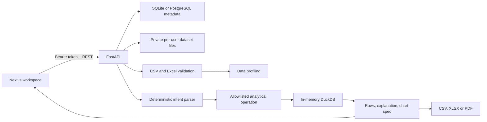

# QueryLens

QueryLens is a local-first data analysis workspace. Upload CSV or Excel files, inspect their profile, and ask a conservative deterministic parser to produce restricted aggregations, distributions, previews, or correlations. It works without an LLM and never executes model-generated Python or user-supplied SQL.

## Status checklist

- [x] CSV/XLSX/XLS ingestion, size and dimension limits, header normalization
- [x] Per-account dataset ownership, account registration/login, password hashing, signed expiring bearer tokens
- [x] Profiling: types, missingness, unique values, numeric summaries, IQR outlier indicators, duplicates, correlations
- [x] Typed deterministic intent parser; asks for clarification on unsupported or ambiguous requests
- [x] Restricted DuckDB query path with escaped allowlisted identifiers, bounded results, memory/thread limits
- [x] Analysis history and CSV, XLSX, PDF exports
- [x] Responsive dark workspace with functional overview, dataset, analysis, query history/replay, settings, and documentation views
- [x] Bar and line charts, vertical/horizontal bar configuration, accessible correlation heatmap, and bounded plotting
- [x] Docker files, sample data, API docs, architecture and benchmark runner
- [x] Backend tests for ingestion, profiling, intent, filters, sorting, safety, accuracy, auth, isolation, provenance, and exports
- [x] Versioned SQLite and PostgreSQL schema migrations
- [x] Browser end-to-end journey and screenshot of an analyzed sample
- [x] Production signing-secret checks, tab-scoped sessions, configurable local rate limits, and DuckDB resource bounds
- [x] Validated filter/sort/group operations and reproducibility metadata with dataset fingerprints
- [ ] HttpOnly cookie sessions, shared multi-worker rate limiting, and operational monitoring

The checked items are implemented; unchecked items are known work, not completed features. Do not expose this deployment directly to the public internet without addressing the listed production gaps.

## Architecture



Uploaded names are reduced to basenames for display; generated UUIDs determine on-disk names. Dataset lookup always includes the authenticated owner ID. Analysis SQL is constructed only from parser-selected columns that exist in the uploaded frame, with identifiers escaped and fixed result limits. User text is never treated as SQL.

## Run on Windows

Python 3.12 and Node.js 20+ are recommended. Open two PowerShell terminals from the repository root.

### Backend

```powershell
py -3.12 -m venv .venv
.\.venv\Scripts\Activate.ps1
cd backend
python -m pip install -e ".[dev]"
$env:QUERYLENS_SECRET_KEY = python -c "import secrets; print(secrets.token_urlsafe(48))"
$env:QUERYLENS_DATA_DIR = "$PWD\..\data"
uvicorn app.main:app --reload
```

Interactive API docs: <http://localhost:8000/docs>.

### Frontend

In a second PowerShell terminal opened at the repository root:

```powershell
cd frontend
npm ci
$env:NEXT_PUBLIC_API_URL = "http://localhost:8000"
npm run dev
```

Open <http://localhost:3000>, create an account, upload `sample-data/sales.csv`, and try “Which product generated the highest revenue?” or “Show distribution of revenue”.

### Docker Compose

Copy `.env.example` to `.env`, replace the signing key and PostgreSQL password, then run `docker compose up --build`. Compose starts PostgreSQL for metadata and persists it and the dataset files in Docker volumes. For a direct local backend run, SQLite remains the default. The frontend API URL is embedded at build time, so set `NEXT_PUBLIC_API_URL` in the Compose build args when accessing it from another host.

## Tests and benchmark

```powershell
cd backend
python -m pytest -q
python benchmark.py
```

The benchmark generates a deterministic 100,000-row in-memory frame and reports measured profiling/analysis duration and peak working set. See [the recorded measurement](docs/performance.md). For the browser journey, start the backend as above, then run `npm run e2e` from `frontend`; it saves `screenshots/analysis-workspace.png`.

## Supported question shapes

- “Average revenue by region”
- “Which product generated the highest revenue?”
- “Lowest units by product”
- “Show unusual values in revenue” (IQR indicator; not an error diagnosis)
- “Show monthly sales growth” (sums a date-aware measure and calculates period-over-period change)
- “Correlation between revenue and units”
- “Spearman correlation between revenue and units”
- “Show a preview”

Supported filters include equals/not equals, numeric and date comparisons, contains/starts with, missing/not missing, and between; conditions can be combined with AND or OR. Sorting and grouped top/bottom results are bounded to 500 rows and 500 groups. Columns should be named explicitly when multiple numeric measures exist. The parser's supported language is heuristic and responds with a clarification where it cannot identify a supported operation. Monthly/daily time series are period totals and change, not forecasts. Statistical significance tests are not implemented. Correlation is association, not causation.

## Data and security notes

- Upload maximum: 25 MB; 500,000 rows; 300 columns.
- Metadata uses SQLite by default or PostgreSQL when `QUERYLENS_DATABASE_URL` is configured. Dataset files remain in `QUERYLENS_DATA_DIR` on the API host.
- Authentication uses bcrypt password hashes and 12-hour signed bearer tokens. Production mode rejects missing, placeholder, short, or low-diversity signing secrets. The browser keeps its token in tab-scoped `sessionStorage`; same-origin JavaScript can still access it, so this is not a complete production session design.
- Local in-process rate limits cover signup, login, analysis, and exports without Redis. Counters and the analysis concurrency cap are per process, so multi-worker deployments do not share counters.
- DuckDB operates on a registered in-memory dataframe. The application does not accept SQL input. Results are capped at 500 rows (50,000 source rows for correlation/distribution calculations), per-statement timeout defaults to 5 seconds, concurrency defaults to two analyses, and DuckDB memory defaults to 512 MB.
- CSV and Excel exports escape formula-like text values while preserving numeric cells. Time-series output labels absent periods and missing/zero baselines rather than treating absent periods as zero.
- XLS legacy files require `xlrd`; XLSX uses `openpyxl`. Encrypted files are rejected with a parse error.
- PDF exports include dataset/question/calculation metadata and up to 35 result rows; XLSX exports have Results and Analysis sheets.
- No local model is bundled or downloaded. LLM integration is not implemented and inference is disabled.

## API outline

FastAPI OpenAPI is served at `/openapi.json`, with interactive docs at `/docs`.

| Route | Purpose |
|---|---|
| `POST /api/auth/register`, `/api/auth/login` | Create account / obtain bearer token |
| `GET /api/datasets` | List caller-owned datasets |
| `POST /api/datasets` | Upload CSV/XLSX/XLS |
| `GET /api/datasets/{id}` | Profile and preview |
| `DELETE /api/datasets/{id}` | Delete dataset and analysis history |
| `POST /api/datasets/{id}/analyze` | Parse and execute a question |
| `GET /api/datasets/{id}/history` | Recent understood queries |
| `POST /api/datasets/{id}/export` | Export a question result as csv/xlsx/pdf |

## Development notes

Dependencies are pinned in `backend/pyproject.toml` and `frontend/package.json`. `npm install` creates the lockfile for repeatable `npm ci`. Sample expected calculations are exercised in backend tests. Authentication and uploaded file data are intentionally not committed.

See [technical notes](docs/technical.md) for the request lifecycle, operation schema, storage design, and configuration.
